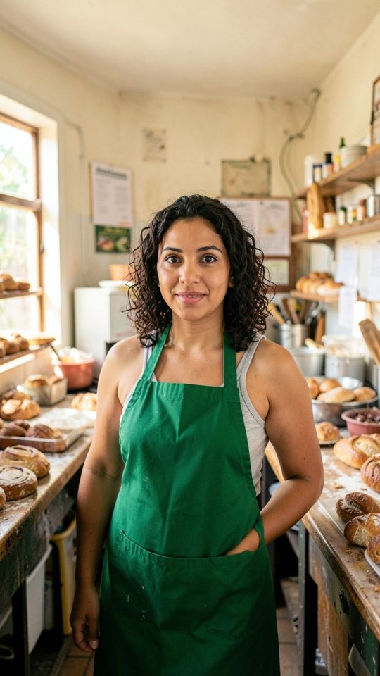
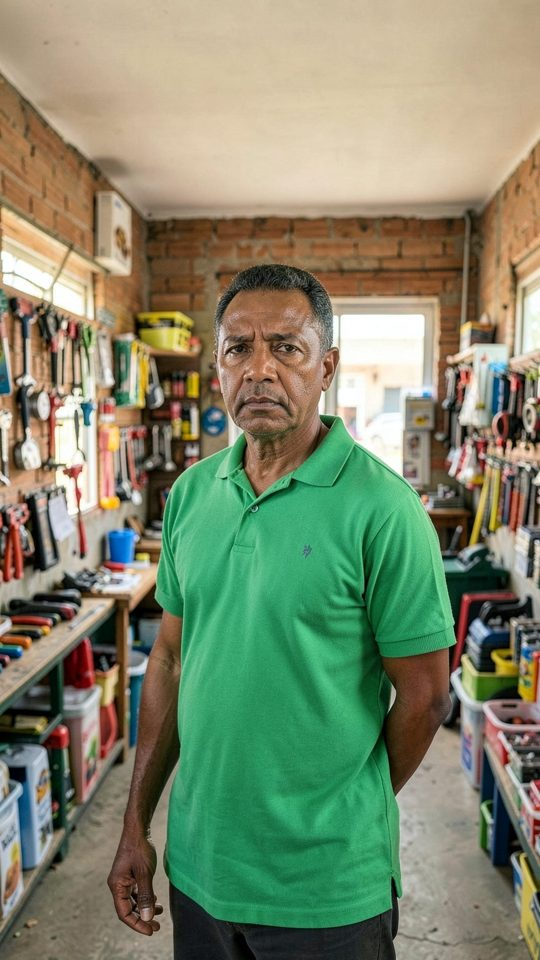
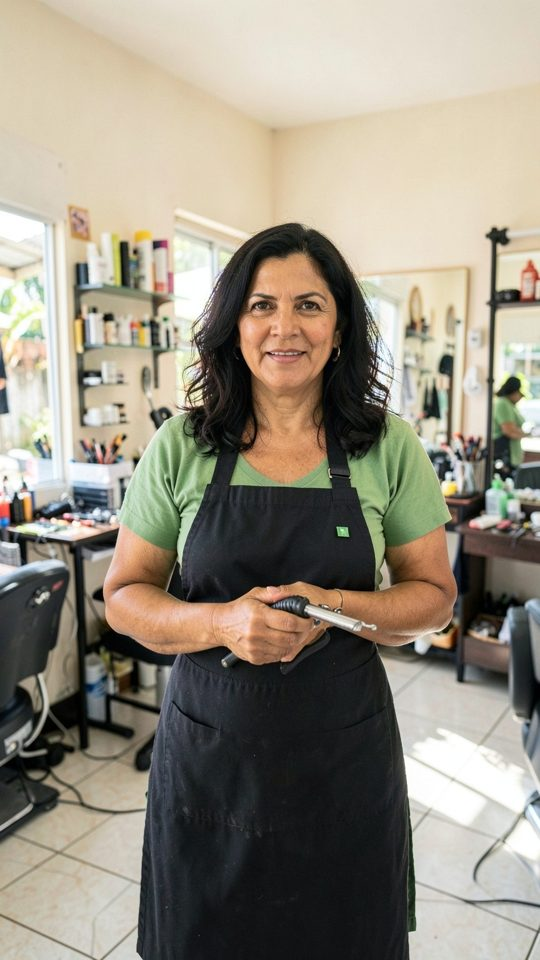
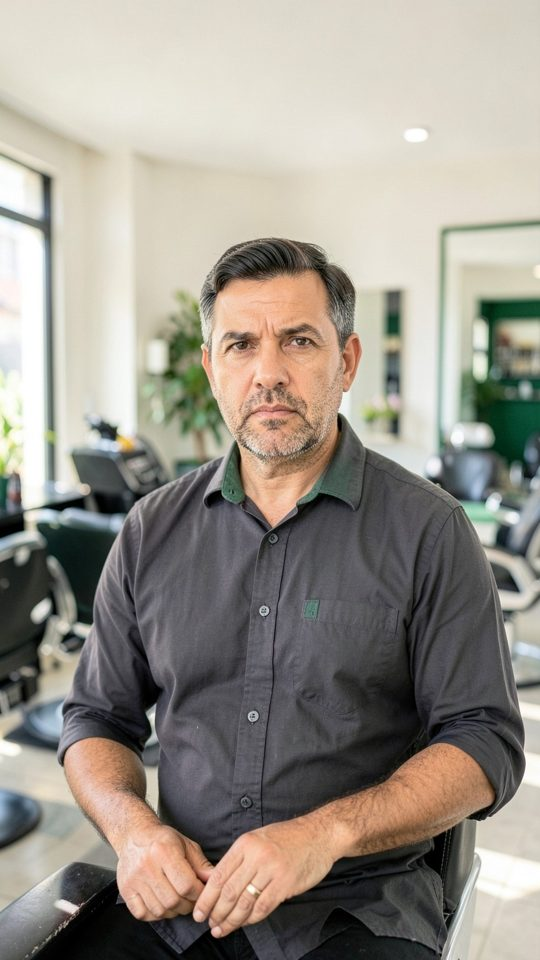
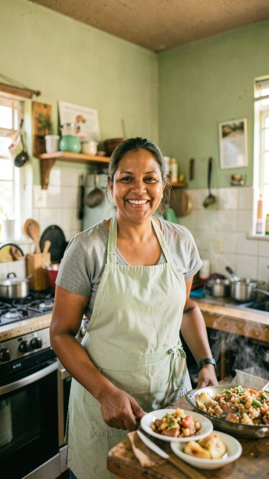
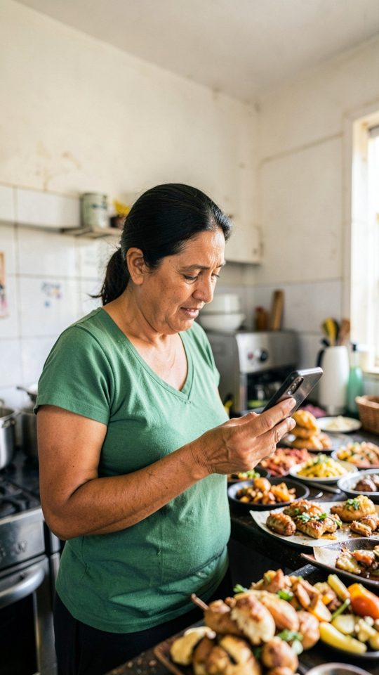

# Playbook de conteúdo da @impulsostone

O que os Reels de maior engajamento entre micro e pequenos empreendedores têm em comum, e como levar isso para a @impulsostone.

TAPI Stone × Inteli Academy · gerado em 24/11/2026 por `scripts/gerar_playbook.py` a partir da base do projeto (7.554 Reels coletados; 4.719 de 83 perfis no ranking).

Este documento é para a equipe que planeja e grava os Reels da @impulsostone. Cada recomendação vem com o número que a sustenta, o grau de confiança e Reels reais para assistir. Os criativos do fim são roteiros prontos para gravar.

**Como ler os selos.** *Diferença clara*: o padrão aparece bem mais (ou bem menos) no top e resiste aos testes. *Indício*: aparece mais no top, mas o sinal é mais fraco; vale testar. *Sem diferença*: o top e os Reels comuns não se distinguem nisso. *Poucos dados*: não dá para dizer.

## Resumo em uma página

1. **Faça vídeos longos, de mais de 90 s, que ensinem algo com calma.** São 32% dos Reels do top e 16% dos comuns (2,0× mais comum no top). Na @impulsostone, hoje, são 5%. *Diferença clara.*
2. **Abra com curiosidade.** Uma situação ou um dado que pede explicação: 36% dos Reels do top × 28% dos comuns. Na @impulsostone, 7%. *Indício.*
3. **Fuja do meio-termo de 30 a 60 s.** Essa faixa é 1,5× menos comum no top (21% × 31%): ou uma ideia só em até 30 s, ou o assunto aprofundado em mais de 90 s. *Diferença clara.*
4. **Rosto, dor real, prova social e frase motivacional não fazem um Reel engajar.** São tão comuns no top quanto nos Reels comuns: podem estar no vídeo, mas não são o diferencial. Data comemorativa aparece até menos no top, mas esse sinal depende de poucos criadores.
5. **Termine sempre com um próximo passo claro.** O CTA não muda o engajamento (67% × 62%), mas o objetivo da @impulsostone é a inscrição, e reação não é clique: sem chamada, quem gostou do vídeo não vira lead.

## Como chegamos aqui

- **Base:** Reels públicos de perfis que falam com micro e pequenos empreendedores (finanças, precificação, marketing, alimentação, beleza, contabilidade e outros), publicados entre 14/11/2025 e 31/10/2026 (a coleta foi até 14/11/2026, mas os Reels com menos de 14 dias ficaram fora do ranking), coletados pela rota definida no case.
- **Métrica:** taxa de engajamento = (curtidas + comentários) ÷ seguidores do perfil. Ela compara perfis pequenos e grandes de igual para igual; o número absoluto de curtidas favorece as contas grandes.
- **Top × controle:** os 472 Reels de maior taxa (os 10% de cima) foram comparados a 472 Reels sorteados do restante, na mesma proporção de perfis micro, médios e grandes. Uma característica só conta como padrão do top se aparecer mais nele do que nos Reels comuns; aparecer muito no top não basta, porque pode ser só o jeito de todo mundo fazer.
- **Leitura dos vídeos:** o Gemini assistiu a cada Reel da amostra (8 quadros, transcrição do áudio e legenda) e preencheu uma ficha fixa: formato, gancho, tema, duração, CTA, rosto em cena e outros. Uma amostra de 50 Reels foi conferida por outro modelo (Claude), sem ver a resposta do Gemini.
- **Concentração:** os 6 criadores com mais Reels no top somam 37% dele. Cada achado foi refeito sem eles; os que somem sem esses 6 aparecem aqui como *depende de poucos criadores*.
- **Taxas acima de 100%:** acontecem quando um Reel viraliza e recebe mais curtidas do que o perfil tem de seguidores (o alcance vem de quem não segue). São os casos mais fortes do top; o padrão vale para os 472.

## Como é o Reel do top

O retrato dos 472 Reels de maior engajamento: o valor mais comum de cada característica da ficha de leitura. Ao lado, a frequência nos Reels comuns, porque o mais comum no top pode ser só o jeito de todo mundo fazer; a última coluna diz se a característica separa o top dos comuns (detalhes nas seções seguintes).

| Característica | Mais comum no top | No top | Nos comuns | Separa o top? |
|---|---|---|---|---|
| Formato do vídeo | talking head | 34% | 47% | Sem diferença |
| Tema | vendas | 21% | 22% | Sem diferença |
| Tipo de gancho | curiosidade | 36% | 28% | Indício (mais no top) |
| Duração | mais de 90 s | 32% | 16% | Diferença clara (mais no top) |
| Rosto em cena | sim | 81% | 89% | Sem diferença |
| Texto na tela | sim | 93% | 91% | Sem diferença |
| Chamada para ação (CTA) | sim | 67% | 62% | Sem diferença |
| Tipo de CTA | comentar | 38% | 29% | Sem diferença |
| Tom | informal | 41% | 47% | Sem diferença |
| Ritmo de cortes | lento | 42% | 44% | Sem diferença |
| Tamanho da legenda | longa | 45% | 47% | Sem diferença |

### Recorte por tema

Quantos Reels do top tratam de cada tema e, dentro de cada tema, o formato, o gancho e a duração mais comuns, com um Reel real para assistir (o de maior engajamento do tema).

| Tema | Reels no top | Nos comuns | Formato mais comum | Gancho mais comum | Duração mais comum | Exemplo | Separa o top? |
|---|---|---|---|---|---|---|---|
| Vendas | 99 (21%) | 22% | talking head | promessa | 60 a 90 s | [DeDBfLQyvu3](https://www.instagram.com/reel/DeDBfLQyvu3/) @penteadokaique | Sem diferença |
| Gestão | 97 (21%) | 23% | talking head | curiosidade | mais de 90 s | [DeuE5VWotiU](https://www.instagram.com/reel/DeuE5VWotiU/) @agafestlocacoes | Sem diferença |
| Outro | 91 (19%) | 17% | talking head | curiosidade | mais de 90 s | [DXmVljvjWHR](https://www.instagram.com/reel/DXmVljvjWHR/) @soucarolssoares | Sem diferença |
| Marketing | 71 (15%) | 11% | explicativo | promessa | 30 a 60 s | [DZYbcAfCwQc](https://www.instagram.com/reel/DZYbcAfCwQc/) @rayssamedrado | Sem diferença |
| Finanças | 51 (11%) | 18% | talking head | dor | 60 a 90 s | [DSAMnSmDTiZ](https://www.instagram.com/reel/DSAMnSmDTiZ/) @contadora.naiale | Sem diferença |
| História de empreendedor | 36 (8%) | 3% | depoimento | curiosidade | mais de 90 s | [DZqVCbmgu2X](https://www.instagram.com/reel/DZqVCbmgu2X/) @conicesar | Sem diferença |
| Motivação | 17 (4%) | 4% | talking head | promessa | até 15 s | [DfAPiukxKrP](https://www.instagram.com/reel/DfAPiukxKrP/) @josikonkol | Poucos dados |
| Ferramentas e maquininha | 6 (1%) | 1% | bastidores | curiosidade | 30 a 60 s | [DS0lcF5j9XL](https://www.instagram.com/reel/DS0lcF5j9XL/) @rannallygomes | Poucos dados |
| Atendimento | 4 (1%) | 2% | explicativo | polêmica | 60 a 90 s | [DbnuKRmRJ_H](https://www.instagram.com/reel/DbnuKRmRJ_H/) @_kalps23 | Poucos dados |

### Recorte por formato

O mesmo, por formato de vídeo: quanto cada formato aparece no top, sobre o que costuma falar e quanto dura.

| Formato | Reels no top | Nos comuns | Tema mais comum | Gancho mais comum | Duração mais comum | Exemplo | Separa o top? |
|---|---|---|---|---|---|---|---|
| Talking head | 160 (34%) | 47% | vendas | curiosidade | mais de 90 s | [DZYbcAfCwQc](https://www.instagram.com/reel/DZYbcAfCwQc/) @rayssamedrado | Sem diferença |
| Explicativo | 92 (20%) | 9% | vendas | curiosidade | 60 a 90 s | [DbnuKRmRJ_H](https://www.instagram.com/reel/DbnuKRmRJ_H/) @_kalps23 | Indício (mais no top), depende de poucos criadores |
| Tutorial | 58 (12%) | 8% | marketing | promessa | 60 a 90 s | [DSS-3BDgWx6](https://www.instagram.com/reel/DSS-3BDgWx6/) @brunabarros.flora | Sem diferença |
| Bastidores | 43 (9%) | 12% | outro | curiosidade | até 15 s | [DcdmwlcOQEZ](https://www.instagram.com/reel/DcdmwlcOQEZ/) @marinatavora | Sem diferença |
| Depoimento | 28 (6%) | 3% | história de empreendedor | curiosidade | mais de 90 s | [DbLn745giR1](https://www.instagram.com/reel/DbLn745giR1/) @conicesar | Sem diferença |
| Humor/esquete | 26 (6%) | 4% | gestão | curiosidade | até 15 s | [Dcegd4WCUhi](https://www.instagram.com/reel/Dcegd4WCUhi/) @mariliasartori.modamkt | Sem diferença |
| Lista de dicas | 22 (5%) | 6% | vendas | número | até 15 s | [DeuE5VWotiU](https://www.instagram.com/reel/DeuE5VWotiU/) @agafestlocacoes | Sem diferença |
| Vlog lifestyle | 17 (4%) | 6% | outro | curiosidade | até 15 s | [DXmVljvjWHR](https://www.instagram.com/reel/DXmVljvjWHR/) @soucarolssoares | Poucos dados |
| Outro | 15 (3%) | 6% | outro | promessa | até 15 s | [DYZ2Cm-gLFH](https://www.instagram.com/reel/DYZ2Cm-gLFH/) @redemulherempreendedora | Poucos dados |
| Trend | 5 (1%) | 0% | outro | curiosidade | 30 a 60 s | [DSAMnSmDTiZ](https://www.instagram.com/reel/DSAMnSmDTiZ/) @contadora.naiale | Poucos dados |
| POV | 3 (1%) | 1% | outro | curiosidade | 30 a 60 s | [DZKy8quxv06](https://www.instagram.com/reel/DZKy8quxv06/) @hannycristina | Poucos dados |
| Antes e depois | 3 (1%) | 0% | marketing | curiosidade | 30 a 60 s | [DdoXUNlI9BE](https://www.instagram.com/reel/DdoXUNlI9BE/) @oficialpudimdacris | Poucos dados |

Com menos de 20 Reels no top, a linha aparece como *Poucos dados*. Algumas linhas dizem *Sem diferença* mesmo com números distantes (talking head, história de empreendedor): a margem de erro é calculada por perfil, e essas diferenças vêm de poucos criadores, então não dá para afirmar que valem para o top como um todo.

## O que fazer

Características que aparecem mais no top do que nos Reels comuns, da mais à menos confiável.

### Vídeos de mais de 90 s

**32% dos Reels do top × 16% dos Reels comuns** · 2,0× mais comum no top · *Diferença clara*

Vídeos longos aparecem 2× mais no top: quem engaja MPEs explica com calma.

**Como aplicar:**

- Reserve os vídeos longos para conteúdo que ensina: um passo a passo, uma conta feita na tela, um erro comum explicado do começo ao fim.
- Mantenha o ritmo com texto na tela e exemplos concretos (valores, situações do dia a dia do negócio), não com cortes rápidos: vários Reels longos do top têm poucos cortes.
- Use a legenda para repetir o conteúdo em tópicos; quem salva o vídeo volta para ela.

Para assistir:

| Reel | Perfil | Gancho (primeiros segundos) | Duração | Engajamento |
|---|---|---|---|---|
| [DettqnjB8Kq](https://www.instagram.com/reel/DettqnjB8Kq/) | @penteadokaique | "Você abre o cardápio e vê um vinho de 900 reais" | 1 min 52 s | 436% |
| [DZqVCbmgu2X](https://www.instagram.com/reel/DZqVCbmgu2X/) | @conicesar | "Eu trabalhei em comércio, eu saí tem 2 meses" | 2 min 34 s | 87% |
| [Deu-wVnxorw](https://www.instagram.com/reel/Deu-wVnxorw/) | @willianmuller_ | "Se você colocar um anúncio no Instagram e mandar todo mundo direto pro seu WhatsApp" | 1 min 42 s | 54% |

### Gancho de curiosidade

**36% dos Reels do top × 28% dos Reels comuns** · 1,3× mais comum no top · *Indício*

Gancho de curiosidade aparece um pouco mais no top; vale testar.

**Como aplicar:**

- Abra com uma situação ou um dado que pede explicação ("Por que o cliente acha caro um preço que é justo?"), e só entregue a resposta depois de alguns segundos.
- A curiosidade precisa ser cumprida no vídeo: gancho que promete e não entrega afasta.

Para assistir:

| Reel | Perfil | Gancho (primeiros segundos) | Duração | Engajamento |
|---|---|---|---|---|
| [DeDBfLQyvu3](https://www.instagram.com/reel/DeDBfLQyvu3/) | @penteadokaique | "Você nunca compra o copo grande de refrigerante" | 1 min 04 s | 881% |
| [DZYbcAfCwQc](https://www.instagram.com/reel/DZYbcAfCwQc/) | @rayssamedrado | "Foi essa frase que me fez decidir começar a gravar conteúdo aqui" | 32 s | 130% |
| [DewuYINxd8J](https://www.instagram.com/reel/DewuYINxd8J/) | @willianmuller_ | "Como uma academia lucra até com quem nunca aparece" | 1 min 13 s | 89% |

### Gancho de polêmica

**5% dos Reels do top × 2% dos Reels comuns** · 2,6× mais comum no top · *Indício*

Gancho polêmico aparece mais no top, mas é raro (5%) e pode não combinar com o tom da Stone.

**Como aplicar:**

- Discordar de um conselho comum ("Parar de dar desconto pode aumentar suas vendas") funciona no top, mas é raro (5% dos Reels).
- No tom da @impulsostone, prefira a polêmica que desafia uma crença do negócio, nunca uma pessoa ou um grupo.

Para assistir:

| Reel | Perfil | Gancho (primeiros segundos) | Duração | Engajamento |
|---|---|---|---|---|
| [DbnuKRmRJ_H](https://www.instagram.com/reel/DbnuKRmRJ_H/) | @_kalps23 | "E o caso polêmico dessa doceira?" | 1 min 02 s | 1917% |
| [DeKjikXv9NZ](https://www.instagram.com/reel/DeKjikXv9NZ/) | @oficialpudimdacris | "Eu posso ser cancelada, mas pudim de qualidade NÃO se faz apenas com leite condensado caro." | 9 s | 4,1% |
| [DXhUzQJjjIX](https://www.instagram.com/reel/DXhUzQJjjIX/) | @ravisbakery_ | "Não compartilhar minhas receitas é mediocridade?" | 1 min 31 s | 3,6% |

### Formato explicativo

**20% dos Reels do top × 9% dos Reels comuns** · 2,2× mais comum no top · *Indício* · depende de poucos criadores

Explicar um conceito do negócio (por que algo acontece) aparece 2× mais no top, mas o sinal depende de poucos criadores (some sem os 6 maiores); vale testar.

**Como aplicar:**

- Parta de uma cena do dia a dia (o cliente que pede desconto, o caixa que não fecha) e explique o porquê dela, com um exemplo de valores.
- Combina com os vídeos longos: o explicativo é o formato mais natural para passar de 90 s sem enrolar.
- Como o sinal vem de poucos criadores, trate como teste: compare a taxa desses Reels com a dos outros.

Para assistir:

| Reel | Perfil | Gancho (primeiros segundos) | Duração | Engajamento |
|---|---|---|---|---|
| [DetwvASxPzG](https://www.instagram.com/reel/DetwvASxPzG/) | @willianmuller_ | "Se você abrir uma loja e colocar os produtos nas prateleiras" | 1 min 23 s | 325% |
| [DYr5RfFxsmO](https://www.instagram.com/reel/DYr5RfFxsmO/) | @camilafarani | "A cena clássica que ensina mais sobre vendas do que muito curso pago" | 1 min 01 s | 43% |
| [DeKzo_zCTpl](https://www.instagram.com/reel/DeKzo_zCTpl/) | @rayssamedrado | "Cliente não compra de quem apenas oferece o produto" | 55 s | 18% |

## O que evitar

Características que aparecem menos no top do que nos Reels comuns.

### Vídeos de 30 a 60 s

**21% dos Reels do top × 31% dos Reels comuns** · 1,5× menos comum no top · *Diferença clara*

A faixa de 30 a 60 s é menos comum no top: nem tão curto para prender, nem longo para aprofundar.

**Como aplicar:**

- Se o assunto cabe em 30 a 60 s, avalie se ele fica melhor curto (até 30 s, uma ideia só) ou aprofundado (mais de 90 s).

### Data comemorativa

**4% dos Reels do top × 10% dos Reels comuns** · 2,1× menos comum no top · *Indício* · depende de poucos criadores

Datas comemorativas aparecem MENOS no top orgânico, ao contrário dos anúncios da Stone (Festa Junina); o sinal é fraco (some sem os 6 maiores criadores): a data sozinha não parece segurar o engajamento.

**Como aplicar:**

- Datas comemorativas aparecem menos no top orgânico (ao contrário dos anúncios da Stone, em que a Festa Junina foi bem). Use a data como pano de fundo de um conteúdo útil, não como o assunto do Reel.

## O que não faz diferença no engajamento

Hipóteses comuns (algumas vindas dos anúncios da própria Stone) que os dados não confirmam nos Reels orgânicos. Não quer dizer que devam sair dos vídeos: quer dizer que não são o que separa um Reel de alto engajamento de um comum. Nenhuma muda quando se tiram os 6 maiores criadores.

| Característica | No top | Nos comuns | Leitura |
|---|---|---|---|
| Prova social | 16,5% | 11,4% | Prova social aparece um pouco mais no top, mas a diferença não é confiável. |
| Chamada para ação | 67,2% | 62,3% | Ter CTA não muda o engajamento; mas para a Stone o CTA serve ao clique, não à curtida. |
| Histórias reais | 17,8% | 14,0% | Histórias reais aparecem um pouco mais no top, sem diferença confiável. |
| Frase motivacional genérica (o que não funcionou nos anúncios) | 22,7% | 21,8% | Frase motivacional genérica não aparece mais nem menos no top: não é o que engaja. |
| Convite à participação (o post de maior CTR da Stone) | 3,2% | 3,2% | Convite à participação é raro nos Reels de criadores: poucos dados para dizer; o sucesso dele nos anúncios da Stone segue sendo a melhor evidência. |
| Dor real do empreendedor | 42,2% | 46,8% | Falar de uma dor real é comum no top, mas não separa o top dos Reels comuns. |
| Pessoas reais em cena | 81,4% | 88,6% | Mostrar o rosto é o padrão no top, mas não diferencia: os Reels comuns também mostram. |
| Comentários com intenção de contato (indicador de lead) | 4,8% | 4,6% | Comentários com intenção de contato ('quero', 'qual o link') são 4,8% no top e 4,6% no controle: engajar mais não traz mais pedidos de contato. |

**O que isso muda na prática:** pessoa real em cena e depoimento continuam bem-vindos, mas sozinhos não seguram a atenção; o que segura é o conteúdo (o que a pessoa ensina ou revela) e a abertura. E o CTA fica em todo vídeo pelo motivo certo: levar à inscrição, não ganhar curtidas.

## Onde a @impulsostone está hoje

Os 56 Reels da @impulsostone publicados entre 22/04 e 13/11/2026 passaram pela mesma leitura da amostra e foram comparados ao top. A taxa de engajamento mediana do perfil é 0,8%, o que a põe no meio dos 15 perfis micro do ranking: acima de 8 deles e abaixo de 7. Como são só 56 Reels, as porcentagens têm margem larga; por isso só chamamos de lacuna clara o que fica longe do top mesmo contando essa margem.

| Característica | @impulsostone | Top | Comuns | Situação |
|---|---|---|---|---|
| Duração: mais de 90 s | 5% (3 de 56) | 32% | 16% | **Usa pouco** (lacuna clara) |
| Tipo de gancho: curiosidade | 7% (4 de 56) | 36% | 28% | **Usa pouco** (lacuna clara) |
| Tipo de gancho: polêmica | 2% (1 de 56) | 5% | 2% | Usa pouco (para observar) |
| Duração: 30 a 60 s | 27% (15 de 56) | 21% | 31% | Usa demais (para observar) |
| Data comemorativa: sim | 11% (6 de 56) | 4% | 10% | Usa demais (para observar) |
| Formato do vídeo: explicativo | 16% (9 de 56) | 20% | 9% | Igual ao top |
| Rosto em cena: sim | 80% | 81% | 89% | Não faz diferença |
| Chamada para ação (CTA): sim | 89% | 67% | 62% | Não faz diferença |
| Abordagem: dor real | 48% | 42% | 47% | Não faz diferença |
| Prova social: sim | 16% | 16% | 11% | Não faz diferença |
| Abordagem: motivacional genérica | 36% | 23% | 22% | Não faz diferença |
| Fala de negócio: sim | 100% | 84% | 86% | Não faz diferença |

**As duas mudanças com mais potencial:**

- **Duração: mais de 90 s:** 3 de 56 Reels da @impulsostone (5%), contra 32% dos Reels do top.
  Os que a @impulsostone já fez nessa linha e que mais engajaram: [DdpARpcyoTh](https://www.instagram.com/reel/DdpARpcyoTh/) ("O cliente fez um pedido urgente para ontem e você já disse sim?"), [DadA4S8BKzG](https://www.instagram.com/reel/DadA4S8BKzG/) ("Hoje vou mostrar para vocês como funciona a nossa plataforma").
- **Tipo de gancho: curiosidade:** 4 de 56 Reels da @impulsostone (7%), contra 36% dos Reels do top.
  Os ganchos desse tipo que a @impulsostone já usou são mais fracos que os do top (força média de 5,0 × 7,1 de 10, na leitura dos vídeos). Para se inspirar, veja as aberturas do top no banco de ganchos, mais abaixo.

O retrato do perfil hoje: formato do vídeo mais comum: talking head (32%); tipo de gancho mais comum: dor (34%); duração mais comum: até 15 s (34%).

## Perfis para se inspirar

Os criadores com mais Reels entre os de maior engajamento, com o tema e o formato que mais usam. Servem como referência de linguagem e de formato (e, quem sabe, de parcerias).

| Perfil | Tamanho | Seguidores | Reels no top | Tema mais comum | Formato mais comum |
|---|---|---|---|---|---|
| [@conicesar](https://www.instagram.com/conicesar/) | micro | 5.096 | 35 de 38 | história de empreendedor | depoimento |
| [@willianmuller_](https://www.instagram.com/willianmuller_/) | médio | 22.284 | 34 de 35 | marketing | explicativo |
| [@dhuanysouza](https://www.instagram.com/dhuanysouza/) | médio | 22.334 | 27 de 39 | vendas | talking head |
| [@fabio.morassi](https://www.instagram.com/fabio.morassi/) ¹ | micro | 3.376 | 27 de 42 | gestão | explicativo |
| [@brunabarros.flora](https://www.instagram.com/brunabarros.flora/) | médio | 15.633 | 25 de 31 | vendas | talking head |
| [@oficialpudimdacris](https://www.instagram.com/oficialpudimdacris/) | micro | 9.345 | 25 de 49 | vendas | bastidores |
| [@rayssamedrado](https://www.instagram.com/rayssamedrado/) | micro | 6.004 | 16 de 39 | vendas | talking head |
| [@penteadokaique](https://www.instagram.com/penteadokaique/) | micro | 2.282 | 13 de 15 | vendas | explicativo |
| [@_kalps23](https://www.instagram.com/_kalps23/) | micro | 972 | 13 de 13 | finanças | talking head |
| [@nathfinancas](https://www.instagram.com/nathfinancas/) | grande | 1.094.866 | 13 de 15 | outro | talking head |
| [@larice_](https://www.instagram.com/larice_/) ¹ | grande | 504.222 | 12 de 13 | outro | vlog lifestyle |
| [@caitomaiaoficial](https://www.instagram.com/caitomaiaoficial/) ¹ | grande | 1.445.665 | 10 de 11 | gestão | talking head |
| [@karolinebragaf](https://www.instagram.com/karolinebragaf/) ¹ | grande | 134.200 | 10 de 16 | marketing | talking head |
| [@clarianalima](https://www.instagram.com/clarianalima/) | micro | 9.105 | 10 de 30 | gestão | tutorial |
| [@kelrylene](https://www.instagram.com/kelrylene/) | micro | 8.234 | 10 de 27 | finanças | talking head |

¹ Esconde as curtidas de parte dos Reels; a taxa desses perfis pode estar distorcida.

## Banco de ganchos

Frases reais de abertura dos Reels do top, por tipo de gancho, para inspirar (não para copiar). Em cada tipo, as aberturas mais fortes segundo a leitura dos vídeos, uma por criador (sem os perfis que escondem parte das curtidas, cujo lugar no top pode estar distorcido).

### Curiosidade

36% dos Reels do top × 28% dos comuns · *Indício*

- "Você abre o cardápio e vê um vinho de 900 reais" · @penteadokaique · [DettqnjB8Kq](https://www.instagram.com/reel/DettqnjB8Kq/)
- "Como uma academia lucra até com quem nunca aparece" · @willianmuller_ · [DewuYINxd8J](https://www.instagram.com/reel/DewuYINxd8J/)
- "Essa mulher vende sanduíche por 4 reais e diz que é super lucrativo" · @facoascontas · [Dc05Vy3RYWH](https://www.instagram.com/reel/Dc05Vy3RYWH/)
- "Todo mundo vendendo morango cravejado. Mas quase ninguém fez essa conta." · @_kalps23 · [Dc14ggMxBeo](https://www.instagram.com/reel/Dc14ggMxBeo/)
- "ELA VESTE 36, MAS COMPROU UMA CALÇA 40!" · @atelier_dourado · [De9A_dBhpf2](https://www.instagram.com/reel/De9A_dBhpf2/)

### Polêmica

5% dos Reels do top × 2% dos comuns · *Indício*

- "Eu posso ser cancelada, mas pudim de qualidade NÃO se faz apenas com leite condensado caro." · @oficialpudimdacris · [DeKjikXv9NZ](https://www.instagram.com/reel/DeKjikXv9NZ/)
- "E o caso polêmico dessa doceira?" · @_kalps23 · [DbnuKRmRJ_H](https://www.instagram.com/reel/DbnuKRmRJ_H/)
- "Não compartilhar minhas receitas é mediocridade?" · @ravisbakery_ · [DXhUzQJjjIX](https://www.instagram.com/reel/DXhUzQJjjIX/)
- "Dizem que o lançamento morreu" · @willianmuller_ · [DetyFmuBkJi](https://www.instagram.com/reel/DetyFmuBkJi/)
- "Coisas que a internet viralizou, mas pra mim é consumismo" · @nathfinancas · [DcPGnfnhaok](https://www.instagram.com/reel/DcPGnfnhaok/)

### Promessa

23% dos Reels do top × 23% dos comuns · *Sem diferença*

- "Como ter um site sem gastar um centavo" · @willianmuller_ · [DfBHKcwx7s_](https://www.instagram.com/reel/DfBHKcwx7s_/)
- "Eu abri a minha loja física com 5 mil reais por causa de duas coisas" · @dhuanysouza · [Dbl6yuKoWjB](https://www.instagram.com/reel/Dbl6yuKoWjB/)
- "As dívidas do MEI serão perdoadas" · @kelrylene · [DecigcAqnkT](https://www.instagram.com/reel/DecigcAqnkT/)
- "Se eu decidisse hoje começar meu negócio do zero" · @oficialpudimdacris · [DbWWlQiP5RN](https://www.instagram.com/reel/DbWWlQiP5RN/)
- "Transformei picolé de pudim em R$ 76 mil com 3 mil seguidores" · @estefira · [De4YTkks6i8](https://www.instagram.com/reel/De4YTkks6i8/)

### Dor

18% dos Reels do top × 23% dos comuns · *Sem diferença*

- "Quando você descobre uma dívida de R$ 6 mil porque abriu um MEI em 2020" · @contadora.naiale · [DSAMnSmDTiZ](https://www.instagram.com/reel/DSAMnSmDTiZ/)
- "Eu quase quebrei a minha loja física no 1º mês" · @dhuanysouza · [Dbv0rz7Rysu](https://www.instagram.com/reel/Dbv0rz7Rysu/)
- "Rosa manchando ou derretendo por dentro?" · @brunabarros.flora · [DU8uELigNLn](https://www.instagram.com/reel/DU8uELigNLn/)
- "Dona de loja, quando tu ouve a funcionária atendendo..." · @mariliasartori.modamkt · [Dcegd4WCUhi](https://www.instagram.com/reel/Dcegd4WCUhi/)
- "Se você faz isso, você tem prejuízo vendendo no iFood" · @_kalps23 · [Db_BADvRUZk](https://www.instagram.com/reel/Db_BADvRUZk/)

### Pergunta

9% dos Reels do top × 15% dos comuns · *Sem diferença*

- "Seu catálogo tem um produto de R$ 2 mil?" · @brunabarros.flora · [DeISybVgjIO](https://www.instagram.com/reel/DeISybVgjIO/)
- "Eu não posso colocar uma caixa de exposição como a primeira de chamariz?" · @marinatavora · [DcryQXlOBul](https://www.instagram.com/reel/DcryQXlOBul/)
- "Não sabe o que fazer pra vender mais em julho?" · @hannycristina · [DaL3duBR_I0](https://www.instagram.com/reel/DaL3duBR_I0/)
- "Como você marca o ajuste da calça jeans?" · @atelier_dourado · [Dee_AlNh9Wc](https://www.instagram.com/reel/Dee_AlNh9Wc/)
- "O Brasil acabou? O que vai ser do Brasil agora?" · @geracaodevalor · [DfAJ3Umh5Rx](https://www.instagram.com/reel/DfAJ3Umh5Rx/)

### Número

4% dos Reels do top × 5% dos comuns · *Poucos dados*

- "4 coisas que eu não uso nos meus buquês" · @brunabarros.flora · [DdBrGDbAIN8](https://www.instagram.com/reel/DdBrGDbAIN8/)
- "7 erros que eliminei na minha produção e fizeram meus pudins venderem 3x mais!" · @oficialpudimdacris · [DcehOyGPzg0](https://www.instagram.com/reel/DcehOyGPzg0/)
- "3 dicas para você que quer empreender com brinquedos" · @agafestlocacoes · [DeuE5VWotiU](https://www.instagram.com/reel/DeuE5VWotiU/)
- "Quatro formas de ter um perfil com alta percepção de valor" · @estefira · [DU_yxnnEpX_](https://www.instagram.com/reel/DU_yxnnEpX_/)
- "Esses foram os 10 maiores acertos da minha loja" · @dhuanysouza · [DbEJi3rI-zy](https://www.instagram.com/reel/DbEJi3rI-zy/)

## Criativos prontos para gravar

Gerados pelo agente do projeto (modo `gerar_criativo`) a partir dos achados acima e conferidos por um revisor automático (citações e tom da @impulsostone). Cada um traz os Reels reais que o inspiraram. São versões preliminares: a equipe ajusta a fala, grava e edita. As capas são uma sugestão visual geradas por IA (FLUX.2 no Cloudflare Workers AI, a partir do prompt de cada criativo); a foto real do Reel deve seguir a mesma ideia, com uma pessoa real.

### 1. O mistério do dinheiro que sumiu

**Formato:** explicativo · **duração:** 90 a 105 s

**Gancho:** Você sabe por que tem tanto empreendedor(a) que vende bem todo dia, mas chega no fim do mês sem dinheiro na conta pessoal?

| Tempo | O que acontece | Texto na tela |
|---|---|---|
| 0–3 s | A apresentadora olha para a câmera com tom curioso e faz a pergunta inicial sobre a falta de saldo pessoal apesar de boas vendas. | Vende muito e não vê a cor do dinheiro? |
| 3–25 s | Ela explica que pagar compras da casa direto com a conta da empresa cria uma ilusão financeira, impedindo de enxergar o lucro real. | Misturar contas esconde o lucro real |
| 25–55 s | Ela demonstra a importância de definir um valor fixo mensal de retirada, o famoso pró-labore, para organizar as despesas da família. | Defina seu pró-labore mensal |
| 55–85 s | Ela orienta os passos básicos para ter uma conta exclusiva para o negócio e manter os comprovantes separados. | Separar a conta é ter clareza |
| 85–105 s | Ela faz o convite caloroso para o empreendedor se inscrever no programa Impulso Stone e aprender mais na prática. | Inscreva-se no Impulso Stone! |

**Legenda:**

> Vender bem é ótimo, mas ver o dinheiro sumir no fim do mês dá uma dor de cabeça, né? Quando a gente paga as contas da casa direto do caixa da loja, fica impossível saber se o negócio está dando lucro de verdade. Definir um pró-labore e separar as contas é o primeiro passo para ter tranquilidade financeira. Quer aprender a organizar suas finanças na prática com mentoria gratuita? Inscreva-se no Impulso Stone! O link está no nosso perfil. #ImpulsoStone #Empreendedorismo #EducaçãoFinanceira #Gestão

**CTA:** Inscreva-se no Impulso Stone para aprender a organizar as finanças do seu negócio na prática!

**Inspirado em:** [Dc05Vy3RYWH](https://www.instagram.com/reel/Dc05Vy3RYWH/) (@facoascontas, "Essa mulher vende sanduíche por 4 reais e diz que é super lucrativo"); [DettqnjB8Kq](https://www.instagram.com/reel/DettqnjB8Kq/) (@penteadokaique, "Você abre o cardápio e vê um vinho de 900 reais")

**Achados aplicados:** duração: mais de 90 s (2,0× mais comum no top); formato do vídeo: explicativo (2,2× mais comum no top), depende de poucos criadores; tipo de gancho: curiosidade (1,3× mais comum no top)

Prompt da capa (9:16) para gerar a imagem

Impulso Stone visual style: bright, warm documentary photography of real small businesses in Brazil; ordinary, approachable Brazilian entrepreneurs aged 30 to 60, diverse in skin tone and body type; Stone green (#00A868) accents in clothing, objects or background, never as a logo; natural light; realistic, not glossy advertising; vertical 9:16 composition with clean empty space in the top third for a text overlay. No text, letters, logos or watermarks in the image; papers, screens and signs are blank or out of focus; natural hands and anatomy.
Main character: A friendly 38-year-old Latina woman with curly dark hair wearing a stylish green apron in a bright small bakery.
This image (Reel cover): A small business owner standing in her bakery looking at the camera with an intrigued expression.

### 2. O perigo do Pix no CPF

**Formato:** explicativo · **duração:** 95 a 110 s

**Gancho:** Misturar o Pix da sua vida pessoal com as vendas do seu negócio pode estar matando o seu lucro sem você perceber.

| Tempo | O que acontece | Texto na tela |
|---|---|---|
| 0–3 s | O apresentador faz um alerta direto sobre o hábito de receber pagamentos do negócio na chave Pix pessoal. | Pix no CPF para receber do negócio? |
| 3–30 s | Ele explica como essa prática confunde o fluxo de caixa e impede o controle exato dos custos da loja. | Fluxo de caixa bagunçado prejudica o negócio |
| 30–60 s | Ele compartilha a regra das duas contas: uma para a empresa receber e pagar fornecedores, outra para o dinheiro pessoal. | 2 contas simples: PJ para loja, PF para você |
| 60–90 s | Ele reforça como a clareza nos números traz segurança para fazer o negócio crescer sem sobressaltos. | Clareza nos números traz crescimento |
| 90–110 s | Ele convida o público a participar das turmas gratuitas do Impulso Stone para estruturar a gestão da loja. | Vem pro Impulso Stone! |

**Legenda:**

> Receber as vendas do negócio na conta pessoal parece prático, mas bagunça todo o seu caixa! Sem separar o dinheiro da empresa do seu dinheiro pessoal, você corre o risco de pagar contas sem saber de onde veio a verba. Bora profissionalizar a gestão do seu negócio? O Impulso Stone oferece oficinas e mentorias gratuitas para microempreendedores. Participe do Impulso Stone e garanta sua vaga! Clique no link da bio. #ImpulsoStone #PequenosNegocios #Finanças #GestaoDeCaixa

**CTA:** Garanta sua vaga no Impulso Stone e receba mentoria gratuita para organizar suas contas!

**Inspirado em:** [DXaTt7Pj5DY](https://www.instagram.com/reel/DXaTt7Pj5DY/) (@gislainebarbosaoficial, "Ter vício não é bom, mas já experimentou PARAR de Receber Pix no CPF?")

**Achados aplicados:** duração: mais de 90 s (2,0× mais comum no top); formato do vídeo: explicativo (2,2× mais comum no top), depende de poucos criadores; tipo de gancho: polêmica (2,6× mais comum no top)

Prompt da capa (9:16) para gerar a imagem

Impulso Stone visual style: bright, warm documentary photography of real small businesses in Brazil; ordinary, approachable Brazilian entrepreneurs aged 30 to 60, diverse in skin tone and body type; Stone green (#00A868) accents in clothing, objects or background, never as a logo; natural light; realistic, not glossy advertising; vertical 9:16 composition with clean empty space in the top third for a text overlay. No text, letters, logos or watermarks in the image; papers, screens and signs are blank or out of focus; natural hands and anatomy.
Main character: A focused 45-year-old Black man with short black hair wearing a polo shirt with a green collar inside a small hardware store.
This image (Reel cover): A hardware store owner standing confidently in his shop looking serious yet welcoming.

### 3. O Cálculo da Escova Perfeita

**Formato:** explicativo · **duração:** 95 a 110 s · setor: beleza

**Gancho:** Você calcula o preço da escova pelo tempo de cadeira ou pelo produto que gasta no lavatório?

| Tempo | O que acontece | Texto na tela |
|---|---|---|
| 0–3 s | A empreendedora olha para a câmera no salão enquanto segura um secador de cabelo e faz a pergunta direta sobre precificação. | Cobrando certo na beleza? |
| 3–25 s | Ela explica que somar apenas o custo do shampoo e condicionador é um erro comum que faz o salão perder dinheiro todos os meses. | O erro no custo direto |
| 25–55 s | Demonstra como embutir os custos invisíveis no serviço: água, energia, aluguel, depreciação do secador e as horas trabalhadas. | Custos invisíveis da cadeira |
| 55–80 s | Mostra a diferença entre cobrar por impulso e calcular a margem de lucro real para cada tipo de cabelo ou procedimento. | Margem de lucro real |
| 80–95 s | Convida os donos de salão a aprenderem a estruturar suas contas e precificar com autonomia no programa gratuito Impulso Stone. | Participe do Impulso Stone! |

**Legenda:**

> Cobrar o valor justo pelo seu trabalho no salão não é questão de sorte, é gestão! Quando você entende onde cada centavo da sua água, luz e produto se encaixa, a sua margem de lucro aparece. Quer aprender a precificar seus serviços de beleza sem medo de perder cliente? Inscreva-se no programa gratuito Impulso Stone e fortaleça seu negócio! #ImpulsoStone #Empreendedorismo #SalaoDeBeleza #Precificacao

**CTA:** Inscreva-se no programa gratuito Impulso Stone e aprenda a precificar com segurança no seu salão!

**Inspirado em:** [DettqnjB8Kq](https://www.instagram.com/reel/DettqnjB8Kq/) (@penteadokaique, "Você abre o cardápio e vê um vinho de 900 reais"); [DdpPf7LxX93](https://www.instagram.com/reel/DdpPf7LxX93/) (@zicaassis, "Gente, quero falar uma coisa pra vocês.")

**Achados aplicados:** duração: mais de 90 s (2,0× mais comum no top); formato do vídeo: explicativo (2,2× mais comum no top), depende de poucos criadores; tipo de gancho: curiosidade (1,3× mais comum no top)

Prompt da capa (9:16) para gerar a imagem

Impulso Stone visual style: bright, warm documentary photography of real small businesses in Brazil; ordinary, approachable Brazilian entrepreneurs aged 30 to 60, diverse in skin tone and body type; Stone green (#00A868) accents in clothing, objects or background, never as a logo; natural light; realistic, not glossy advertising; vertical 9:16 composition with clean empty space in the top third for a text overlay. No text, letters, logos or watermarks in the image; papers, screens and signs are blank or out of focus; natural hands and anatomy.
Main character: A 40-year-old Brazilian female hairdresser with dark wavy hair, wearing a dark apron with a subtle green pin, set inside a bright hair salon.
This image (Reel cover): A female salon owner smiling confidently while holding professional styling tools in a well-lit beauty salon.

### 4. Preço Baixo Não Salva Salão

**Formato:** talking head · **duração:** 95 a 105 s · setor: beleza

**Gancho:** Cobrar barato no salão de beleza não atrai mais clientes fiéis, só destrói o seu caixa.

| Tempo | O que acontece | Texto na tela |
|---|---|---|
| 0–3 s | O especialista fala de forma direta e provocativa olhando para a câmera no ambiente do salão de beleza. | Baixar preço destrói seu caixa! |
| 3–30 s | Explica por que dar desconto sem cálculo prévio cria a ilusão de salão cheio, mas deixa a conta bancária no vermelho ao final do mês. | Salão cheio vs. conta no vermelho |
| 30–65 s | Apresenta o conceito de valor percebido no atendimento de beleza: limpeza, pontualidade, café acolhedor e biossegurança valorizam o preço. | Agregue valor ao seu atendimento |
| 65–85 s | Dá o exemplo prático da diferença de faturamento entre quem vende dez cortes baratinhos e quem vende quatro combos completos precificados corretamente. | Combo precificado vs. preço baixo |
| 85–100 s | Faz o convite direto para que empreendedoras e empreendedores da beleza se inscrevam no Impulso Stone para transformar a gestão financeira. | Inscreva-se no Impulso Stone |

**Legenda:**

> Você atende o dia todo, fica exausto(a) e na hora de pagar as contas do salão o dinheiro não sobra? O problema pode estar no preço cobrado por impulso. No Impulso Stone, ajudamos você a calcular seus custos reais e valorizar seu trabalho. Garanta sua vaga gratuita no programa Impulso Stone e transforme a gestão do seu negócio! #ImpulsoStone #GestaoDeSalao #BelezaEAutonomia #VendasQualificadas

**CTA:** Garanta sua vaga gratuita no programa Impulso Stone e receba mentoria prática para o seu salão!

**Inspirado em:** [DWpd-C0gOAN](https://www.instagram.com/reel/DWpd-C0gOAN/) (@conicesar, "Eu sou a Ana, eu tenho 30 anos")

**Achados aplicados:** duração: mais de 90 s (2,0× mais comum no top); tipo de gancho: polêmica (2,6× mais comum no top)

Prompt da capa (9:16) para gerar a imagem

Impulso Stone visual style: bright, warm documentary photography of real small businesses in Brazil; ordinary, approachable Brazilian entrepreneurs aged 30 to 60, diverse in skin tone and body type; Stone green (#00A868) accents in clothing, objects or background, never as a logo; natural light; realistic, not glossy advertising; vertical 9:16 composition with clean empty space in the top third for a text overlay. No text, letters, logos or watermarks in the image; papers, screens and signs are blank or out of focus; natural hands and anatomy.
Main character: A 45-year-old Brazilian male barber and salon consultant, wearing a charcoal shirt with a small green detail on the collar, in a chic salon environment.
This image (Reel cover): A male salon consultant looking directly at the camera with a confident and serious expression inside a professional salon.

### 5. Como calcular o preço e vender pelo WhatsApp

**Formato:** explicativo · **duração:** 95 a 120 s · setor: alimentação

**Gancho:** Você sabe quanto realmente sobra no final do mês com as suas marmitas entregues pelo WhatsApp?

| Tempo | O que acontece | Texto na tela |
|---|---|---|
| 0–3 s | Você sabe quanto realmente sobra no final do mês com as suas marmitas entregues pelo WhatsApp? | Quanto sobra na marmita? |
| 3–30 s | Muitos empreendedores vendem bem no delivery de comida caseira, mas esquecem de colocar todos os custos na ponta do lápis, como a embalagem e o gás. | Custo real da marmita |
| 30–60 s | Quando você ajusta o valor do seu prato e cria combos inteligentes para o WhatsApp, o cliente pede mais vezes e o seu lucro finalmente aparece. | Combos que dão lucro |
| 60–90 s | Eu passei por essa mesma dúvida no meu negócio de comida, aprendendo que gestão organizada muda tudo na rotina de quem vende em casa. | Sua rotina organizada |
| 90–110 s | Empreendedor(a), queremos ajudar o seu negócio de alimentação a crescer de verdade. Participe do Impulso Stone e venha transformar a gestão da sua cozinha. | Participe do Impulso Stone |

**Legenda:**

> Vender comida caseira exige carinho na receita e muita organização nos números. Se você quer aprender a precificar certo e lotar o seu WhatsApp de encomendas sem complicação, nós podemos te ajudar. Empreendedor(a), queremos ajudar o seu negócio de alimentação a crescer de verdade. Participe do Impulso Stone e venha transformar a gestão da sua cozinha.

**CTA:** Participe do Impulso Stone e venha transformar a gestão da sua cozinha.

**Inspirado em:** [DZqVCbmgu2X](https://www.instagram.com/reel/DZqVCbmgu2X/) (@conicesar, "Eu trabalhei em comércio, eu saí tem 2 meses"); [DbsI9LLPQC4](https://www.instagram.com/reel/DbsI9LLPQC4/) (@clarianalima, "Essa é a Engenharia do evento e a aula de hoje é sobre curadoria!")

**Achados aplicados:** duração: mais de 90 s (2,0× mais comum no top)

Prompt da capa (9:16) para gerar a imagem

Impulso Stone visual style: bright, warm documentary photography of real small businesses in Brazil; ordinary, approachable Brazilian entrepreneurs aged 30 to 60, diverse in skin tone and body type; Stone green (#00A868) accents in clothing, objects or background, never as a logo; natural light; realistic, not glossy advertising; vertical 9:16 composition with clean empty space in the top third for a text overlay. No text, letters, logos or watermarks in the image; papers, screens and signs are blank or out of focus; natural hands and anatomy.
Main character: A friendly woman between 35 and 50 years old, wearing a neat home apron with a small green detail, working in a cozy home kitchen.
This image (Reel cover): Vertical cover showing a woman smiling in a home kitchen next to homemade food boxes.

### 6. O segredo para lotar o WhatsApp com comida caseira

**Formato:** explicativo · **duração:** 70 a 90 s · setor: alimentação

**Gancho:** E se o segredo para vender mais comida caseira estivesse em uma simples mensagem no WhatsApp?

| Tempo | O que acontece | Texto na tela |
|---|---|---|
| 0–3 s | E se o segredo para vender mais comida caseira estivesse em uma simples mensagem no WhatsApp? | Segredo no WhatsApp |
| 3–25 s | Muitas pessoas que fazem marmitas ou bolos em casa acham que basta postar foto. Mas o pós-venda e o atendimento rápido é que fazem o cliente voltar toda semana. | Atendimento que fideliza |
| 25–50 s | Com um método prático de atendimento, você transforma quem comprou uma vez em cliente fixo do seu cardápio de delivery. | Cliente fixo toda semana |
| 50–80 s | Empreendedor(a), queremos ver o seu negócio de alimentação alcançar novos clientes todos os dias. Venha fazer parte do Impulso Stone e conquiste sua autonomia. | Venha para o Impulso Stone |

**Legenda:**

> Atender bem pelo WhatsApp é o que diferencia quem vende de quem fideliza no setor de alimentação. Quer aprender estratégias práticas para o seu negócio? Empreendedor(a), queremos ver o seu negócio de alimentação alcançar novos clientes todos os dias. Venha fazer parte do Impulso Stone e conquiste sua autonomia.

**CTA:** Venha fazer parte do Impulso Stone e conquiste sua autonomia.

**Inspirado em:** [DeuZrmYyq2o](https://www.instagram.com/reel/DeuZrmYyq2o/) (@willianmuller_, "Se você abrir uma portinha e vender só o lanche"); [DbnuKRmRJ_H](https://www.instagram.com/reel/DbnuKRmRJ_H/) (@_kalps23, "E o caso polêmico dessa doceira?")

**Achados aplicados:** formato do vídeo: explicativo (2,2× mais comum no top), depende de poucos criadores

Prompt da capa (9:16) para gerar a imagem

Impulso Stone visual style: bright, warm documentary photography of real small businesses in Brazil; ordinary, approachable Brazilian entrepreneurs aged 30 to 60, diverse in skin tone and body type; Stone green (#00A868) accents in clothing, objects or background, never as a logo; natural light; realistic, not glossy advertising; vertical 9:16 composition with clean empty space in the top third for a text overlay. No text, letters, logos or watermarks in the image; papers, screens and signs are blank or out of focus; natural hands and anatomy.
Main character: A welcoming woman in her 40s, wearing a casual top with a small green detail, cooking and managing orders in a home kitchen.
This image (Reel cover): Vertical cover showing a woman looking at her phone with delicious food in the background.

## Limites deste playbook

- **Padrões observados, não garantia.** Os achados mostram o que é mais comum nos Reels de maior engajamento; não provam que a característica causa o engajamento, e não preveem o resultado de um vídeo.
- **Engajamento não é lead.** A métrica é curtida e comentário; o objetivo da @impulsostone é a inscrição. Nos comentários, os pedidos de contato ("quero", "qual o link") são igualmente raros no top e nos comuns (perto de 5%).
- **Só Reels do Instagram**, sem compartilhamentos e salvamentos (não são públicos); carrossel e Shorts ficaram fora.
- **Curtidas ocultas:** perfis que escondem as curtidas de alguns Reels foram tratados à parte; nos que escondem só uma parte, a taxa pode estar otimista.
- **Seguidores de uma data só** (11/11) para todos os Reels, inclusive os mais antigos.
- **Teste e meça.** O melhor uso deste playbook é gravar Reels seguindo as recomendações e comparar a taxa e os cliques deles com os anteriores da @impulsostone.
